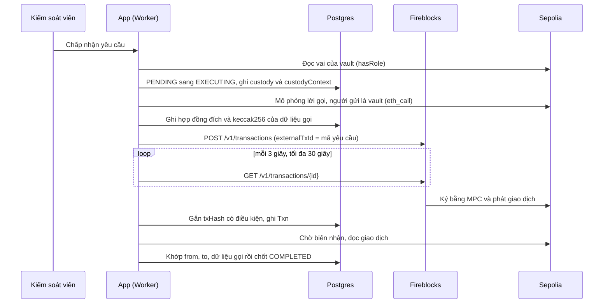

# Runbook Lưu ký Fireblocks (IN-04)

Tài liệu này có hai nửa. Phần A, B là kiến thức nền: Fireblocks là gì, dự án dùng nó vào việc gì, thiết kế ra
sao, phạm vi tới đâu. Phần C tới G là thao tác: cấu hình, bật lần đầu trên Sepolia, vận hành hằng ngày, xử lý sự
cố, đường lùi.

Spec: `docs/in-04-fireblocks-mint-burn/requirements.md` (các mã QĐ-x, A1, C3... dưới đây trỏ vào đó). Bàn giao:
`docs/CHECKPOINT_IN04.md`. Màn hình và câu thông báo: `docs/USER_GUIDE.md` mục 3.0 và 3.4.4. Kết quả thử Sandbox
trước khi làm: K0 (`claude/20261028_ket_qua_K0_fireblocks_sandbox.md`, ngoài repo).

**Runbook không chứa khoá.** Không dán khoá API, khoá riêng RSA, JWT hay chữ ký vào repo, vào chat, vào ảnh chụp
gửi Supervisor. Nơi duy nhất có khoá thật là `.env` trên máy Sếp (đã gitignore) và Cloudflare Secrets.

## Ai làm gì

| Ký hiệu | Vai |
|---|---|
| **Sếp** | Chủ dự án: giữ khoá Fireblocks, khoá quản trị hợp đồng, tài khoản Cloudflare; thao tác tay |
| **SV** | Supervisor: chỉ đọc và soát (mã HTTP, mã giao dịch, Etherscan) |
| **App** | Thao tác trên giao diện app, ghi rõ vai đang dùng |

Ba giá trị dùng xuyên suốt (lấy từ K0, đã đặt sẵn trong `app/wrangler.json`):

| Tên | Giá trị |
|---|---|
| Vault Account | ID `11` |
| Địa chỉ EVM của vault | `0xc7F64D8101a3037850fd4896224cB48D4b1f83F1` |
| Mã tài sản Sepolia ETH trên Fireblocks | `ETH_TEST5` |

---

## Phần A. Kiến thức nền về Fireblocks

### A1. Fireblocks là gì

Fireblocks là nền tảng lưu ký tài sản số cho tổ chức. Điểm cốt lõi: khoá riêng của ví **không nằm trọn ở một
chỗ nào**. Theo tài liệu công khai của Fireblocks, khoá được chia thành nhiều mảnh bằng kỹ thuật tính toán đa bên
(MPC); các mảnh nằm ở hạ tầng Fireblocks và ở thiết bị, máy đồng ký của khách hàng. Khi ký, các bên cùng tính ra
chữ ký mà không bao giờ ghép lại thành khoá đầy đủ. Hệ quả cho ngân hàng:

- Không còn một chuỗi khoá riêng nằm trong biến môi trường của máy chủ (như `SERVER_SIGNER_PRIVATE_KEY` hiện nay).
  Lộ biến môi trường của Worker không còn đồng nghĩa với lộ ví.
- Mỗi giao dịch đi qua Fireblocks có dấu vết riêng (người tạo, thời điểm, trạng thái), xem được trên giao diện web
  của Fireblocks (Console).
- Có lớp chính sách duyệt riêng của Fireblocks (TAP, mục A6). Dự án này **chưa** dùng lớp đó (QĐ-2).

### A2. Các khái niệm cần biết

| Khái niệm | Nghĩa | Trong dự án |
|---|---|---|
| Workspace | Một không gian làm việc của tổ chức trên Fireblocks. Có loại Sandbox (thử, dùng chung hạ tầng, tự duyệt) và loại thật (Testnet, Mainnet) | Dùng Workspace **Sandbox**, đường API `https://sandbox-api.fireblocks.io` |
| Vault Account | "Tài khoản lưu ký" trong Workspace, có ID số. Một vault giữ được nhiều tài sản; với các tài sản trên cùng một mạng EVM, vault có một địa chỉ | Vault `11`, địa chỉ `0xc7F6...83F1`. Đây là **người gửi** giao dịch Mint, Burn trên Sepolia |
| Asset ID | Mã Fireblocks đặt cho một tài sản trên một mạng. Giao dịch gọi hợp đồng trên EVM khai mã của đồng tiền gốc (để trả phí) | `ETH_TEST5` là ETH trên Sepolia. Vault phải có ETH này để trả gas |
| API User | Tài khoản máy của Workspace: gồm **khoá API** (chuỗi định danh) và một cặp khoá RSA do mình tạo. Fireblocks giữ khoá công khai, mình giữ khoá riêng để ký mỗi yêu cầu | Hai bí mật `FIREBLOCKS_API_KEY`, `FIREBLOCKS_SECRET_KEY` |
| Transaction | Một lệnh gửi lên Fireblocks; có `id` của Fireblocks, `status`, `subStatus`, và `txHash` khi đã phát lên chuỗi | Mỗi yêu cầu Mint, Burn có nhiều nhất MỘT transaction |
| Operation `CONTRACT_CALL` | Loại transaction gọi một hàm hợp đồng: số tiền `0`, kèm dữ liệu gọi (`contractCallData`) | Gọi `mint`, `mintInitialSupply`, `burn` trên `ProjectToken` |
| Destination `ONE_TIME_ADDRESS` | Đích là một địa chỉ ghi thẳng trong lệnh, không cần khai trước trong danh bạ của Workspace | Đích là địa chỉ `ProjectToken` |
| `externalTxId` | Mã do phía mình đặt cho transaction. Fireblocks từ chối mã trùng (mã lỗi 1438) và cho tra lại theo mã này | Đặt bằng **mã yêu cầu** của app: chống gửi trùng, tra lại được sau lỗi mạng |
| TAP | Transaction Authorization Policy: bộ luật của Workspace quyết định ai phải duyệt giao dịch nào | Không dùng (Sandbox không cho cấu hình, QĐ-2) |
| Webhook | Fireblocks gọi ngược về máy chủ mình khi trạng thái đổi | Không dùng; app tự hỏi lại trạng thái |
| Gas Station | Dịch vụ tự nạp phí gas cho vault | Không dùng; Sếp nạp ETH tay |

### A3. Xác thực mỗi lời gọi API

Fireblocks không dùng phiên đăng nhập. **Mỗi** yêu cầu HTTP mang hai tiêu đề:

- `X-API-Key: <khoá API>`
- `Authorization: Bearer <JWT>`, JWT ký RS256 bằng khoá riêng RSA, sống 25 giây, phần thân gồm:
  - `uri`: đường dẫn kể cả `/v1` và chuỗi truy vấn;
  - `nonce`: UUID mới mỗi lần;
  - `iat`, `exp` (`exp = iat + 25`);
  - `sub`: khoá API;
  - `bodyHash`: SHA-256 dạng hex của đúng chuỗi thân gửi đi (chuỗi rỗng với GET).

Vì JWT gắn với đúng đường dẫn và đúng thân, bắt được một JWT cũng không dùng lại được cho lời gọi khác, và hết
hạn sau 25 giây. Khoá riêng RSA phải ở dạng **PKCS#8** (dòng đầu `BEGIN PRIVATE KEY`). Khoá dạng PKCS#1 (dòng đầu
`BEGIN RSA PRIVATE KEY`) phải đổi trước (mục C2).

### A4. Ba lời gọi dự án dùng

| Lời gọi | Dùng khi |
|---|---|
| `POST /v1/transactions` | Tạo transaction `CONTRACT_CALL`. Chỉ ở lần duyệt, mỗi yêu cầu một lần |
| `GET /v1/transactions/{id}` | Hỏi trạng thái theo mã Fireblocks (khi đã biết mã) |
| `GET /v1/transactions/external_tx_id/{externalTxId}` | Tra theo mã yêu cầu. Chưa có thì Fireblocks trả HTTP 404 kèm mã lỗi 1439 ("No such External Tx ID") |

### A5. Vòng đời trạng thái và cách app hiểu

Trạng thái Fireblocks **không** quyết định kết cục của yêu cầu; biên nhận trên chuỗi mới quyết định (QĐ-8). App
chỉ dùng trạng thái Fireblocks để biết đã có mã giao dịch chưa, hoặc chắc chắn chưa phát lên chuỗi chưa
(`classifyFireblocksTx`, `lib/custody/fireblocks-execution.ts`):

| Trạng thái Fireblocks | Nghĩa | App xử lý |
|---|---|---|
| Bất kỳ trạng thái nào mà đã có `txHash` | Đã phát lên chuỗi | Gắn mã vào yêu cầu, chờ biên nhận như đường khoá máy chủ |
| `SUBMITTED`, `PENDING_SIGNATURE`, `QUEUED`, `BROADCASTING` và các trạng thái chờ khác, chưa có `txHash` | Đang xử lý | Chờ, hỏi lại mỗi 3 giây tới hết `FIREBLOCKS_HASH_WAIT_MS`; hết giờ thì giữ Đang thực hiện |
| `CONFIRMING`, `COMPLETED` | Đã lên chuỗi (luôn có `txHash`) | Như dòng đầu |
| `CANCELLED`, `BLOCKED`, `REJECTED` không có `txHash` | Chắc chắn không phát | Yêu cầu Thất bại |
| `FAILED` với `subStatus` `INSUFFICIENT_FUNDS_FOR_FEE`, không có `txHash` | Vault thiếu ETH trả phí, bị từ chối trước khi phát (đã thấy ở K0) | Yêu cầu Thất bại |
| `FAILED` với `subStatus` khác, không có `txHash` | Không chắc | Giữ Đang thực hiện, ghi lý do để đối soát tay |

Diễn biến đo được ở K0 trên Sandbox: `SUBMITTED` (2 giây), `PENDING_SIGNATURE` (8 giây), `CONFIRMING` có `txHash`
(14 giây), `COMPLETED` (55 giây). Vì vậy `FIREBLOCKS_HASH_WAIT_MS` mặc định 30 giây là đủ để thường lấy được mã
ngay trong lần duyệt.

### A6. Sandbox khác môi trường thật ở đâu

| | Sandbox (đang dùng) | Workspace thật (chưa làm) |
|---|---|---|
| Duyệt giao dịch | Tự duyệt, tự ký | Theo TAP; ký tự động cho API cần máy đồng ký (API Co-Signer) của khách hàng, hoặc người duyệt trên thiết bị |
| Chính sách | Không cấu hình được | Cấu hình được, nên dùng làm lớp duyệt thứ hai |
| Đích `ONE_TIME_ADDRESS` | Dùng được | Có thể phải bật trong cài đặt Workspace hoặc chuyển sang hợp đồng đã khai trong danh bạ |
| Tài sản | Testnet (`ETH_TEST5`) | Theo mạng thật |

Cột bên phải là ghi chú định hướng, cần kiểm lại theo tài liệu Fireblocks khi lên môi trường thật.

---

## Phần B. Dự án dùng Fireblocks thế nào

### B1. Bài toán

Trước IN-04, mọi giao dịch phía ngân hàng trên EVM ký bằng một khoá riêng đặt ở máy chủ. Mint, Burn đi theo luồng
lập và duyệt: Giao dịch viên lập, Kiểm soát viên duyệt; lúc duyệt, máy chủ ký và gửi `mint`, `mintInitialSupply`
hoặc `burn` lên `ProjectToken`. IN-04 cho phép lần duyệt đó **gửi qua một Vault Account của ngân hàng trên
Fireblocks** thay cho khoá máy chủ, bật tắt bằng một công tắc.

### B2. Phạm vi

**Trong phạm vi:**

- Ba lời gọi của luồng lập và duyệt: `mintInitialSupply`, `mint` (cần `MINTER_ROLE`) và `burn` (cần `AGENT_ROLE`)
  trên `ProjectToken` (QĐ-3).
- Chỉ chain có trong bảng `FIREBLOCKS_CHAIN_ASSETS`; mặc định chỉ Sepolia (`evm:ETH_TEST5`) (QĐ-4).
- Công tắc "Lưu ký Fireblocks" ở đáy menu Giao dịch viên, Kiểm soát viên (QĐ-5).
- Đối soát yêu cầu Fireblocks chưa rõ kết quả bằng nút "Đối soát" ở `/approvals/[id]`.

**Ngoài phạm vi (vẫn ký bằng khoá máy chủ hoặc chưa làm):**

- Trang ẩn `/mint`, phát hành thử, đốt theo lô khi thu hồi (BE-05), vault, chia lợi nhuận, VNDB.
- Phía Nhà đầu tư (vault Nhà đầu tư, ký permit, rút VNDB qua vault), Embedded Wallets.
- TAP, webhook, Gas Station; giao dịch bị thay mã (`replacedTxHash`, tăng tốc).
- Đóng tay yêu cầu kẹt Đang thực hiện: task L-15.

### B3. Kiến trúc

Không dùng SDK của Fireblocks. App tự viết một khách REST nhỏ bằng `fetch` và Web Crypto (QĐ-10): chỉ cần ba lời
gọi, tránh thêm khoảng 395 KiB nén và `axios` vào Worker Cloudflare. K0 câu 6 đã chứng minh cách này chạy được
trong workerd.

| Thành phần | Tệp | Việc |
|---|---|---|
| Cấu hình | `app/src/lib/config/env.ts`, `app/src/lib/custody/fireblocks-config.ts` | Đọc, kiểm biến môi trường; `fireblocksConfig()` (khoá, vault, `configRef`) và `fireblocksChainScope()` (bảng chain) đọc độc lập |
| Khách REST | `app/src/lib/custody/fireblocks-client.ts` | Ký JWT, gọi ba endpoint, phân loại lỗi tạo giao dịch (`classifyCreateError`) |
| Thực hiện | `app/src/lib/custody/fireblocks-execution.ts` | Gửi qua Fireblocks, chờ mã, phân loại trạng thái, khớp giao dịch trên chuỗi, đối soát |
| Công tắc | `app/src/lib/bank/custody.service.ts`, `app/src/app/actions/custody.ts`, `components/layout/custody-toggle.tsx` | Đọc, đổi `SystemConfig` khoá `custody.fireblocks.enabled`; chọn cách thực hiện (`custodyFor`) |
| Luồng duyệt | `app/src/lib/bank/token-request.service.ts`, `issuance.service.ts` | Chọn cách thực hiện lúc duyệt, gọi đường Fireblocks hoặc khoá máy chủ, đối soát |
| Ledger EVM | `app/src/lib/ledger/evm.adapter.ts` | Đọc vai của vault, mô phỏng lời gọi với người gửi là vault, đọc giao dịch trên chuỗi |
| Lưu trữ | `TokenRequest` thêm `custody`, `custodyTxId`, `custodyContext` | Ghi cách thực hiện và bối cảnh ký |
| Kịch bản vai | `packages/contracts-evm/scripts/fireblocks-roles.js` | Xem, cấp, thu hồi `MINTER_ROLE`, `AGENT_ROLE` cho vault |

Luồng một lần duyệt Mint qua Fireblocks:



### B4. Các nguyên tắc thiết kế

1. **Công tắc là giá trị người vận hành chọn, không tự đổi** (QĐ-13). Công tắc tắt, hoặc chain không có trong
   bảng: dùng khoá máy chủ. Công tắc bật cho chain này: dùng Fireblocks. Công tắc bật mà thiếu cấu hình, khoá sai
   dạng, bảng chain sai, hay đọc trạng thái lỗi: **chặn lần duyệt**, yêu cầu giữ Chờ duyệt. Không bao giờ âm thầm
   quay về khoá máy chủ.
2. **Kiểm trước khi gửi** (QĐ-9). Trước khi chiếm quyền: vault phải có `MINTER_ROLE` (Mint) hoặc `AGENT_ROLE`
   (Burn), thiếu thì chặn. Sau khi chiếm quyền: mô phỏng lời gọi với người gửi là vault; hợp đồng từ chối thì yêu
   cầu Thất bại, chưa gửi gì tới Fireblocks.
3. **Chốt bối cảnh ký lúc duyệt** (QĐ-6). Cùng câu chuyển sang Đang thực hiện, app ghi `custodyContext`: mã tham
   chiếu cấu hình (`configRef`, 16 ký tự hex đầu của SHA-256 của `baseUrl|apiKey`, không lộ khoá), vault ID, địa
   chỉ ký, mã tài sản, chain, rồi hợp đồng đích và dấu `keccak256` của dữ liệu gọi. Không lưu khoá. Đối soát về sau
   dùng bối cảnh đã ghi, không theo công tắc hay cấu hình hiện tại.
4. **Không gửi trùng** (QĐ-7). `externalTxId` là mã yêu cầu; mỗi yêu cầu chỉ có một lời gọi tạo, ở lần duyệt. Đối
   soát chỉ tra, **không bao giờ tạo** giao dịch mới.
5. **Phân loại lỗi tạo theo mã lỗi Fireblocks trước, HTTP sau** (QĐ-7c):
   - mã 1438 (trùng `externalTxId`): giao dịch đã có, tra lại;
   - mã từ chối đồng bộ (900, 1409, 1502, 1503, 1004, 11001, 1407, 1402, 1404, 1424, 1432, -7, -8: dữ liệu sai,
     tài sản sai, vault sai, thiếu quyền, thiếu số dư, địa chỉ sai, xác thực sai): tra lại, Fireblocks trả đúng
     1439 thì yêu cầu Thất bại;
   - HTTP 429, 5xx, lỗi mạng, hết giờ, mã lạ: chưa biết, tra lại; không thấy thì giữ Đang thực hiện.
6. **Nghi ngờ thì giữ Đang thực hiện** (QĐ-7b, QĐ-8, QĐ-8b). Một khi đã gọi tạo giao dịch, chỉ ba lối được ghi
   Thất bại: trạng thái chắc chắn chưa phát (mục A5), từ chối đồng bộ rồi tra thấy 1439, hoặc biên nhận trên chuỗi
   thất bại. Không tự kết luận "Fireblocks không có giao dịch" theo thời gian.
7. **Khớp giao dịch trước khi chốt** (QĐ-15). Biên nhận thành công rồi vẫn chỉ Hoàn tất khi giao dịch trên chuỗi
   có người gửi là vault, đích là `ProjectToken`, và `keccak256(input)` bằng dấu đã ghi. Lệch thì giữ Đang thực
   hiện, sổ kiểm toán FAILURE, cần đối soát tay.
8. **Một lượt gắn mã thắng** (QĐ-16). Lần duyệt và lần đối soát có thể chạy cùng lúc; gắn `txHash` bằng câu có
   điều kiện (đang thực hiện và chưa có mã). Chỉ lượt thắng ghi dòng `Txn` và chốt; lượt thua trả "Yêu cầu đang
   được đối soát ở lượt khác.".
9. **Cấu hình đổi thì dừng đối soát** (QĐ-14). Khoá API hoặc vault hiện tại khác bối cảnh đã ghi: không tra, báo
   "Cấu hình Fireblocks đã đổi so với lúc duyệt (vault ...); phục hồi cấu hình cũ để đối soát.".
10. **Khoá chỉ ở bí mật** (QĐ-11). Không ghi khoá, JWT, chữ ký vào log, sổ kiểm toán, câu lỗi.

### B5. Bảng chọn cách thực hiện (`custodyFor`)

| Công tắc | Bảng chain | Chain của yêu cầu | Kết quả |
|---|---|---|---|
| Tắt | bất kỳ | bất kỳ | Khoá máy chủ |
| Bật | sai dạng | bất kỳ | Chặn: "Bảng chain của Lưu ký Fireblocks sai (...); chưa duyệt được." |
| Bật | hợp lệ | không có trong bảng | Khoá máy chủ (ví dụ `mock`) |
| Bật | hợp lệ | có trong bảng, cấu hình đủ | Fireblocks |
| Bật | hợp lệ | có trong bảng, thiếu cấu hình | Chặn: "Lưu ký Fireblocks đang bật nhưng thiếu cấu hình (...); chưa duyệt được." |
| Đọc lỗi | | | Chặn: "Không đọc được trạng thái Lưu ký Fireblocks; thử lại." |

### B6. Dữ liệu ghi lại

| Nơi | Trường | Ý nghĩa |
|---|---|---|
| `TokenRequest.custody` | `SERVER` hoặc `FIREBLOCKS` | Cách thực hiện chốt lúc duyệt |
| `TokenRequest.custodyContext` | JSON `{ configRef, vaultId, address, assetId, chain, contract, callDataHash }` | Bối cảnh ký, không bí mật |
| `TokenRequest.custodyTxId` | Mã transaction của Fireblocks | Để tra theo mã khi đối soát |
| `Txn.actorAddress` | Địa chỉ vault | Người gửi của giao dịch qua Fireblocks |
| `SystemConfig` khoá `custody.fireblocks.enabled` | `true`, `false`; có lịch sử `SystemConfigHistory` | Công tắc, mặc định tắt khi chưa có dòng |
| AuditLog | `custody:toggle`, `order:approve`, `token:mint`, `token:burn` | Ai bật tắt, lần duyệt nào bị chặn, chưa rõ, khớp lệch |
| Fireblocks Console | `note` = `IN-04 <MINT hoặc BURN> <mã yêu cầu>`, `externalTxId` = mã yêu cầu | Tìm giao dịch tương ứng trên Fireblocks |

---

## Phần C. Cấu hình

### C1. Biến môi trường

| Biến | Bí mật | Nơi đặt trên Cloudflare | Mặc định | Ý nghĩa |
|---|---|---|---|---|
| `FIREBLOCKS_API_KEY` | Có | Worker runtime **Secret** | không | Khoá API của API User |
| `FIREBLOCKS_SECRET_KEY` | Có | Worker runtime **Secret** | không | Khoá riêng RSA, PEM PKCS#8; cho phép `\n` thay xuống dòng |
| `FIREBLOCKS_BASE_URL` | Không | `app/wrangler.json` `vars` | `https://sandbox-api.fireblocks.io` | Đường API của Workspace |
| `FIREBLOCKS_VAULT_ID` | Không | `app/wrangler.json` `vars` | không (wrangler đặt `"11"`) | Vault gửi giao dịch |
| `FIREBLOCKS_VAULT_ADDRESS` | Không | `app/wrangler.json` `vars` | không (wrangler đặt `0xc7F6...83F1`) | Địa chỉ EVM của vault; app dùng để kiểm vai, mô phỏng, khớp |
| `FIREBLOCKS_CHAIN_ASSETS` | Không | `app/wrangler.json` `vars` | `evm:ETH_TEST5` | Bảng `chain:assetId` cách nhau bằng dấu phẩy, chỉ chain họ EVM. Một phần tử sai là cả bảng không dùng được. Đặt rỗng là không chain nào dùng Fireblocks |
| `FIREBLOCKS_HASH_WAIT_MS` | Không | tuỳ chọn | `30000` | Thời gian tối đa chờ Fireblocks trả mã giao dịch trong một lần duyệt |

Thiếu một trong bốn trường bắt buộc (hai khoá, vault ID, địa chỉ vault đúng dạng) thì "chưa cấu hình": công tắc
không bật được. Câu lý do chỉ nêu tên trường thiếu hoặc sai dạng, không in khoá. Khi chạy cục bộ, khai trong
`app/.env` theo mẫu `.env.example`.

### C2. Chuẩn bị khoá riêng RSA

Khoá đã có từ K0 (Sếp giữ). Kiểm dòng đầu của tệp khoá:

- `BEGIN PRIVATE KEY`: đúng PKCS#8, dùng luôn.
- `BEGIN RSA PRIVATE KEY`: PKCS#1, đổi trên máy Sếp:

  ```bash
  openssl pkcs8 -topk8 -nocrypt -in fireblocks_pkcs1.key -out fireblocks_pkcs8.key
  ```

Khoá sai dạng thì app báo một trong ba câu (không in khoá): "là khoá dạng PKCS#1 ...", "không phải khoá PEM
PKCS#8 ...", "có phần thân không phải base64 hợp lệ.". Xoá tệp trung gian sau khi đặt Secret.

---

## Phần D. Bật lần đầu trên Sepolia

Thứ tự bắt buộc: vault có ETH và có vai **trước** khi bật công tắc; bật công tắc **sau** khi kiểm `/lookup404`.

| Bước | Nội dung | Ai |
|---|---|---|
| 0 | Điều kiện vào | Sếp |
| 1 | Nạp SepoliaETH cho vault 11 | Sếp |
| 2 | Cấp `MINTER_ROLE`, `AGENT_ROLE` cho vault | Sếp; SV đọc chuỗi |
| 3 | Đặt hai Secret trên Cloudflare | Sếp |
| 4 | Kiểm đường `/lookup404` | Sếp chạy; SV đối chiếu |
| 5 | Triển khai, bật công tắc, Mint nhỏ, Burn nhỏ | App và Sếp; SV đọc chuỗi |

### Bước 0. Điều kiện vào [Sếp]

- PR IN-04 đã merge vào `dev`, Workers Builds dựng xong bản mới.
- `packages/shared/src/addresses.json` có `ProjectToken` của chain `evm` (bộ hợp đồng đang chạy trên Sepolia).
- Ví quản trị của `ProjectToken` (ví deploy) có quyền cấp vai, khoá nằm trong `packages/contracts-evm/.env` trên
  máy Sếp.

### Bước 1. Nạp SepoliaETH cho vault 11 [Sếp]

Gửi SepoliaETH tới `0xc7F64D8101a3037850fd4896224cB48D4b1f83F1` (từ ví tổng hoặc faucet). Mỗi giao dịch gọi hợp
đồng tốn phí gas nhỏ; nạp đủ cho vài chục giao dịch.

*Phải thấy:* số dư ETH của địa chỉ vault trên Sepolia Etherscan lớn hơn 0; trên Fireblocks Console, vault 11 có số
dư `ETH_TEST5` tương ứng.

Thiếu ETH thì Fireblocks từ chối ngay (`FAILED` / `INSUFFICIENT_FUNDS_FOR_FEE`), yêu cầu Thất bại, không mất gì
trên chuỗi; nạp thêm rồi lập yêu cầu mới.

### Bước 2. Cấp vai cho vault [Sếp; SV đọc chuỗi]

Chạy từ `packages/contracts-evm`:

```bash
# 2a. Xem hiện trạng (mặc định hành động status, không gửi gì)
FIREBLOCKS_VAULT_ADDRESS=0xc7F64D8101a3037850fd4896224cB48D4b1f83F1 \
  npx hardhat run scripts/fireblocks-roles.js --network sepolia

# 2b. Xem kế hoạch cấp (in "DRY-RUN: sẽ gửi ...", chưa gửi)
FIREBLOCKS_VAULT_ADDRESS=0xc7F64D8101a3037850fd4896224cB48D4b1f83F1 FIREBLOCKS_ROLES_ACTION=grant \
  npx hardhat run scripts/fireblocks-roles.js --network sepolia

# 2c. Gửi thật
FIREBLOCKS_VAULT_ADDRESS=0xc7F64D8101a3037850fd4896224cB48D4b1f83F1 FIREBLOCKS_ROLES_ACTION=grant \
  FIREBLOCKS_ROLES_CONFIRM=yes npx hardhat run scripts/fireblocks-roles.js --network sepolia
```

*Phải thấy:* 2c in "Đã gửi ...; tx=0x..." và "CONFIRMED block=..." cho mỗi vai còn thiếu; chạy lại 2a in
`MINTER_ROLE=true` và `AGENT_ROLE=true`. Gửi SV hai mã giao dịch cấp vai.

**Lưu ý an toàn:** `AGENT_ROLE` ngoài Burn còn cho phép đóng băng ví và chuyển cưỡng bức (`forcedTransfer`). Chỉ
cấp cho vault dùng cho luồng lập và duyệt; thu hồi ngay khi thôi dùng (mục F3).

### Bước 3. Đặt hai Secret trên Cloudflare [Sếp]

Đặt `FIREBLOCKS_API_KEY` và `FIREBLOCKS_SECRET_KEY` là Worker runtime **Secret**, bằng Dashboard (Workers, chọn
Worker, Settings, Variables and Secrets) hoặc bằng lệnh từ `app`:

```bash
npx wrangler secret put FIREBLOCKS_API_KEY
npx wrangler secret put FIREBLOCKS_SECRET_KEY < fireblocks_pkcs8.key
```

Lệnh đầu hỏi giá trị ở dấu nhắc, không ghi vào lịch sử shell. **Không** thêm hai khoá vào `wrangler.json`, Build
variables hay tệp nào trong repo. Bốn biến không bí mật đã có sẵn trong `app/wrangler.json` (mục C1); không đặt
lại bằng tay trên Dashboard. `keep_vars=true` trong `wrangler.json` giữ các Secret khi deploy (`docs/DEPLOYMENT.md`).

*Phải thấy:* Dashboard liệt kê hai Secret (giá trị bị ẩn).

### Bước 4. Kiểm đường `/lookup404` [Sếp chạy; SV đối chiếu]

Mục đích: khách REST chỉ coi **đúng** HTTP 404 kèm mã 1439 là "Fireblocks chưa có giao dịch". Nếu Workspace trả
khác (mã khác, thân khác), lần duyệt và đối soát sẽ hiểu sai. Kiểm trước khi bật công tắc.

Chạy đường `/lookup404` của bộ thử K0 câu 6 (`20261029_k0_cau6_fireblocks_workers.zip`, ngoài repo) với cùng khoá
API, khoá riêng. Gửi SV **chỉ** mã HTTP và thân phản hồi, không gửi khoá, JWT.

*Phải thấy:* HTTP 404, thân có mã `1439`. Khác thì dừng, báo để sửa khách REST (requirements B1) trước khi bật.

### Bước 5. Triển khai, bật công tắc, Mint nhỏ, Burn nhỏ [App và Sếp; SV đọc chuỗi]

1. Triển khai lại Worker (Workers Builds hoặc `npx wrangler deploy`) để nhận hai Secret mới.
2. **App, Giao dịch viên hoặc Kiểm soát viên**, chain Sepolia: ở đáy menu, dòng "Lưu ký Fireblocks" hết mờ; bấm bật.
   Công tắc chuyển xanh. Còn mờ với gợi ý "Chưa cấu hình Fireblocks" thì xem lại Bước 3.
3. **App, Giao dịch viên:** lập một yêu cầu Mint số lượng nhỏ.
4. **App, Kiểm soát viên:** mở `/approvals/[id]`. Dòng "Thực hiện qua" phải là "Fireblocks, vault 11 (0xc7F6...)".
   Bấm Chấp nhận.
5. Kết quả mong đợi: trong khoảng 30 giây có mã giao dịch, sau đó Hoàn tất (thông báo xanh). Nếu thông báo vàng
   "Đã gửi Fireblocks, chưa rõ kết quả; bấm Đối soát sau." thì chờ một phút rồi bấm Đối soát.
6. Lặp lại 3 tới 5 với một yêu cầu Burn nhỏ.
7. Kiểm từng mã giao dịch trên Sepolia Etherscan:
   - `From` là `0xc7F64D8101a3037850fd4896224cB48D4b1f83F1` (vault), **không** phải ví ký máy chủ;
   - `To` là `ProjectToken` trong `addresses.json`;
   - hàm gọi là `mint` (hoặc `mintInitialSupply`) và `burn`, trạng thái Success.
8. Trên Fireblocks Console: hai giao dịch có `externalTxId` bằng mã yêu cầu, ghi chú `IN-04 MINT ...`, `IN-04 BURN ...`.

*Phải thấy:* hai yêu cầu Hoàn tất; dòng "Thực hiện qua" có thêm "; mã Fireblocks ..."; sổ kiểm toán có
`custody:toggle` và `order:approve` SUCCESS. Gửi SV hai mã yêu cầu và hai mã giao dịch.

---

## Phần E. Vận hành hằng ngày

### E1. Bật, tắt công tắc

- Ai: Giao dịch viên, Kiểm soát viên (quyền `custody:toggle`). Mỗi lần đổi ghi `SystemConfigHistory` và AuditLog
  `custody:toggle`.
- Chỉ BẬT được khi cấu hình đủ; TẮT luôn được.
- Công tắc áp cho lần duyệt **tiếp theo**. Yêu cầu đã duyệt giữ cách đã ghi: tắt công tắc sau lúc duyệt thì yêu
  cầu đó vẫn đối soát qua Fireblocks.
- Công tắc dùng chung toàn hệ thống, không theo người dùng.

### E2. Đọc dòng "Thực hiện qua" ở `/approvals/[id]`

| Giá trị | Nghĩa |
|---|---|
| "Khoá ký máy chủ" | Chờ duyệt: nếu duyệt bây giờ sẽ ký bằng khoá máy chủ; đã duyệt: đã ký bằng khoá máy chủ |
| "Fireblocks, vault 11 (0xc7F6...)" | Chờ duyệt: sẽ gửi qua vault này; đã duyệt: đã gửi qua vault này |
| ... "; mã Fireblocks <mã>" | Có mã transaction Fireblocks để tra trên Console |
| "Không thực hiện (đã từ chối)" | Yêu cầu bị từ chối |
| "Chưa đọc được" | Đọc công tắc lỗi; tải lại trang |

### E3. Câu thông báo và việc cần làm

| Câu | Nghĩa | Làm gì |
|---|---|---|
| "Vault Fireblocks <địa chỉ> chưa có quyền MINTER_ROLE (hoặc AGENT_ROLE) trên ProjectToken." | Vault thiếu vai, yêu cầu giữ Chờ duyệt | Bước 2 Phần D, rồi duyệt lại |
| "Lưu ký Fireblocks đang bật nhưng thiếu cấu hình (...); chưa duyệt được." | Secret mất hoặc sai dạng | Đặt lại Secret (Bước 3), hoặc tắt công tắc để duyệt bằng khoá máy chủ |
| "Bảng chain của Lưu ký Fireblocks sai (...); chưa duyệt được." | `FIREBLOCKS_CHAIN_ASSETS` có phần tử sai | Sửa `wrangler.json`, triển khai lại |
| "Không đọc được trạng thái Lưu ký Fireblocks; thử lại." | Đọc `SystemConfig` lỗi | Thử lại; kéo dài thì kiểm database |
| "Fireblocks từ chối tạo giao dịch (mã <code>): <message>" | Từ chối đồng bộ, yêu cầu Thất bại, không có gì trên chuỗi | Đọc mã lỗi (thiếu số dư, vault sai, xác thực sai...), sửa rồi lập yêu cầu mới |
| "Fireblocks <status>/<subStatus>, chưa phát lên chuỗi." | Yêu cầu Thất bại | Như trên; `INSUFFICIENT_FUNDS_FOR_FEE` thì nạp ETH (Bước 1) |
| "Đã gửi Fireblocks, chưa rõ kết quả; bấm Đối soát sau." | Lỗi mạng, hết giờ chờ mã, trùng mã | Chờ một phút, bấm Đối soát |
| "Yêu cầu đang được đối soát ở lượt khác." | Một lượt khác đã gắn mã | Tải lại trang sau ít giây |
| "Chưa đọc được Fireblocks; thử lại." | Tra Fireblocks lỗi | Thử lại; kéo dài thì xem trạng thái Fireblocks |
| "Fireblocks chưa có giao dịch của yêu cầu này (mã 1439); giữ Đang thực hiện, cần xử lý tay." | Fireblocks không thấy giao dịch | Tra Console theo mã yêu cầu. Không thấy thật thì chờ task L-15 để đóng tay; **không** lập yêu cầu thay thế trước khi chắc chắn |
| "Cấu hình Fireblocks đã đổi so với lúc duyệt (vault ...); phục hồi cấu hình cũ để đối soát." | Khoá API hoặc vault đã đổi | Đặt lại cấu hình cũ, đối soát xong rồi mới đổi (mục E4) |
| "Giao dịch <hash> không khớp lời gọi đã chuẩn bị; cần đối soát tay." | Giao dịch trên chuỗi khác người gửi, đích hoặc dữ liệu đã chuẩn bị | Dừng, báo SV kèm mã giao dịch; giữ Đang thực hiện chờ L-15 |
| "Fireblocks FAILED/<subStatus> không có mã giao dịch; cần đối soát tay." | Fireblocks thất bại vì lý do khác, không chắc đã phát hay chưa | Xem chi tiết trên Console; chờ L-15 |

### E4. Đổi khoá API, đổi vault

Đối soát so `configRef` và vault ID hiện tại với bối cảnh đã ghi. Vì vậy:

1. Trước khi đổi: không còn yêu cầu Fireblocks nào Đang thực hiện (lọc `/approvals` theo trạng thái, xem dòng
   "Thực hiện qua"). Còn thì bấm Đối soát cho xong.
2. Tắt công tắc.
3. Đổi Secret (hoặc `FIREBLOCKS_VAULT_ID`, `FIREBLOCKS_VAULT_ADDRESS` trong `wrangler.json`), triển khai lại.
4. Vault mới: nạp ETH và cấp vai (Phần D bước 1, 2); thu hồi vai của vault cũ (mục F3).
5. Bật lại công tắc, chạy một Mint nhỏ để kiểm.

---

## Phần F. Sự cố và đường lùi

### F1. Fireblocks gián đoạn

Tắt công tắc: các lần duyệt mới quay về khoá máy chủ (ví deploy vẫn giữ vai). Yêu cầu Fireblocks đang dở vẫn giữ
Đang thực hiện; khi Fireblocks hoạt động lại thì bấm Đối soát. **Không** xoá Secret khi còn yêu cầu dở, vì đối
soát cần cấu hình cũ.

### F2. Nghi lộ khoá Fireblocks

1. Trên Fireblocks Console: vô hiệu hoá API User ngay.
2. Tắt công tắc.
3. Tạo API User mới, đặt Secret mới. Yêu cầu dở của khoá cũ sẽ báo "Cấu hình Fireblocks đã đổi ..."; xử lý tay
   theo Console (L-15).
4. Báo SV thời điểm và phạm vi (không gửi khoá).

### F3. Gỡ hẳn Fireblocks

1. Tắt công tắc.
2. Đối soát xong mọi yêu cầu Fireblocks Đang thực hiện.
3. Thu hồi vai của vault, từ `packages/contracts-evm`:

   ```bash
   FIREBLOCKS_VAULT_ADDRESS=0xc7F64D8101a3037850fd4896224cB48D4b1f83F1 FIREBLOCKS_ROLES_ACTION=revoke \
     npx hardhat run scripts/fireblocks-roles.js --network sepolia            # xem kế hoạch
   FIREBLOCKS_VAULT_ADDRESS=0xc7F64D8101a3037850fd4896224cB48D4b1f83F1 FIREBLOCKS_ROLES_ACTION=revoke \
     FIREBLOCKS_ROLES_CONFIRM=yes npx hardhat run scripts/fireblocks-roles.js --network sepolia
   ```

   *Phải thấy:* hành động `status` in `MINTER_ROLE=false`, `AGENT_ROLE=false`.
4. Xoá hai Secret trên Cloudflare (`npx wrangler secret delete FIREBLOCKS_API_KEY`, tương tự cho khoá riêng).

Không cần đổi mã: thiếu cấu hình thì công tắc không bật được, mọi lần duyệt ký bằng khoá máy chủ.

---

## Phần G. Giới hạn đã chấp nhận và nợ kỹ thuật

- **Không có TAP:** lớp duyệt duy nhất là lập và duyệt của app (QĐ-2).
- **Chỉ Mint, Burn của lập duyệt** (QĐ-3). Các đường khác vẫn ký bằng khoá máy chủ.
- **Yêu cầu chưa rõ giữ Đang thực hiện vô thời hạn** (QĐ-7b): 1439 kéo dài, `FAILED` không mã lý do khác, giao
  dịch không khớp. Đóng tay thuộc L-15.
- **Thiếu dòng `Txn` hiếm gặp** (QĐ-16): tiến trình chết đúng giữa lúc gắn mã và lúc ghi `Txn` thì thiếu một dòng
  `Txn` thông tin; yêu cầu vẫn có mã, sổ kiểm toán và chốt được.
- **Giao dịch bị thay mã** (tăng tốc, `replacedTxHash`): không xử lý.
- **Không webhook:** trạng thái chỉ cập nhật trong lần duyệt và khi bấm Đối soát.
- **Phía Nhà đầu tư, Embedded Wallets, Gas Station:** nợ kỹ thuật định hướng.

---

## Phụ lục. Thử cục bộ không cần Fireblocks thật

Lập trình viên không nhận khoá thật (IN-04). Bộ kiểm thử dùng khách giả `app/test/helpers/fake-fireblocks.ts`:
kịch bản trả mã, chậm, lỗi mạng sau khi đã tạo, lỗi 400, trạng thái âm; chế độ "phát lên nút Hardhat" gửi
`eth_sendTransaction` từ một tài khoản Hardhat đã mở khoá đóng vai vault. Khoá RSA trong test sinh lúc chạy hoặc
là chuỗi giả, không phải khoá thật.

```bash
# Từ app: luồng Fireblocks với khách giả, ledger mock
npx vitest run test/in-04-fireblocks.test.ts

# Luồng thật trên nút Hardhat (gốc repo: USE_LOCAL_SOLC=1 bash scripts/evm-local.sh reset)
TEST_HARDHAT_RPC=http://127.0.0.1:8545 npx vitest run test/in-04-fireblocks-evm.test.ts
```

Bảng chain trong test đặt `hardhat-local:<mã giả>` qua `setFireblocksConfigForTest` để chạy luồng thật trên nút
Hardhat (QĐ-4).

## Lịch sử

| Ngày | Người | Nội dung |
|---|---|---|
| 30/10/2026 | Dev (Claude) | Bản đầu: kiến thức nền, thiết kế, phạm vi, cấu hình, bật lần đầu, vận hành, sự cố, đường lùi |
