<!-- SINH TỰ ĐỘNG TỪ MARKER — ĐỪNG SỬA TAY -->

# Luồng `distribute` — Chia lợi nhuận theo sản lượng

> **Tệp này do `scripts/gen-flow-diagram.mjs` sinh ra từ marker `@flow` trong mã nguồn.**
> Sửa tay sẽ bị ghi đè ở lần sinh sau, và trong khoảng thời gian trước đó thì sơ đồ nói một
> đằng còn mã làm một nẻo. Muốn đổi nội dung thì sửa marker trong mã rồi sinh lại.
>
> - Sinh lại: `node scripts/gen-flow-diagram.mjs distribute`
> - Kiểm tệp này còn khớp marker hay không: `node scripts/gen-flow-diagram.mjs distribute --check`
> - Quy ước marker: `.kiro/steering/make-control.md` mục 4

**24 bước**, gắn ở 4 tệp:

- `app/src/app/actions/distribution.ts`
- `app/src/lib/bank/distribution-approval.service.ts`
- `app/src/lib/bank/distribution.service.ts`
- `app/src/lib/bank/distribution-trigger.service.ts`

## Sơ đồ

```mermaid
flowchart TD
  s1["1 · getDistributionPageAction()<br/>app/src/app/actions/distribution.ts<br/>nhận yêu cầu mở màn chia: tổng quan, trang lịch sử và lịch chạy trong một lượt"]
  s2["2 · getDistributionOverview()<br/>app/src/lib/bank/distribution-approval.service.ts<br/>kiểm quyền reconcile:read, đọc quỹ, dự kiến theo shareOf trên số dư hiện tại, kỳ hoạt động và…"]
  s3["3 · approveDistributionAction()<br/>app/src/app/actions/distribution.ts<br/>nhận lần duyệt chia của Kiểm soát viên kèm số VNDB đã xem trên màn"]
  s4["4 · approveDistribution()<br/>app/src/lib/bank/distribution-approval.service.ts<br/>kiểm quyền distribution:approve, chain phải có vault, số duyệt phải bằng phần chưa phân bổ, giữ…"]
  s5["5 · collectRecipients()<br/>app/src/lib/bank/distribution.service.ts<br/>dựng danh sách người nhận từ ba nguồn nghiệp vụ cộng mọi ví Transfer do Indexer trả"]
  s6["6 · driveOpening()<br/>app/src/lib/bank/distribution.service.ts<br/>mở kỳ trên chuỗi bằng nhãn dùng một lần, lưu mã giao dịch trước khi chờ, tra kỳ trên chuỗi để…"]
  s7["7 · decideApproval()<br/>app/src/lib/bank/distribution.service.ts<br/>so số thực tế của kỳ trên chuỗi với số đã duyệt: đúng thì APPROVED, khác thì AMOUNT_CHANGED và…"]
  s8["8 · reapproveDistributionAction()<br/>app/src/app/actions/distribution.ts<br/>nhận lần duyệt lại số thực tế trên chuỗi của kỳ AMOUNT_CHANGED hoặc kỳ cũ chưa duyệt"]
  s9["9 · reapproveDistribution()<br/>app/src/lib/bank/distribution-approval.service.ts<br/>kiểm quyền distribution:approve, kỳ AMOUNT_CHANGED hoặc chưa duyệt, số duyệt lại phải bằng đúng…"]
  s10["10 · continueDistributionAction()<br/>app/src/app/actions/distribution.ts<br/>nhận yêu cầu tiếp tục kỳ đã duyệt: phục hồi, đối soát vault, chia lô còn lại"]
  s11["11 · continueDistribution()<br/>app/src/lib/bank/distribution-approval.service.ts<br/>kiểm quyền distribution:approve, phục hồi kỳ OPENING, kỳ phải APPROVED, chạy một lượt chia có…"]
  s12["12 · runApprovedPeriod()<br/>app/src/lib/bank/distribution-trigger.service.ts<br/>chiếm số vòng KeeperRun kèm nguồn MANUAL hoặc KEEPER, chạy lõi một lượt chia, đóng vòng và ghi…"]
  s13["13 · runDistributionRound()<br/>app/src/lib/bank/distribution.service.ts<br/>lõi một lượt chia: kỳ phải APPROVED, chốt kỳ vault phải DONE rồi mới lập hồ sơ chờ, đối soát đã…"]
  s14["14 · syncVaultClose()<br/>app/src/lib/bank/distribution.service.ts<br/>đẩy số đã dành cho kỳ vào closePeriod của vault đúng một lần: giữ chỗ mã kỳ vault, đối soát…"]
  s15["15 · allocate()<br/>app/src/lib/bank/distribution.service.ts<br/>đọc số dư từng ví tại ảnh chụp, tính phần chia nhân trước chia sau"]
  s16["16 · settleBalanceMark()<br/>app/src/lib/bank/distribution-trigger.service.ts<br/>ghi mốc số dư đã xử lý sau khi kỳ chia xong trọn vẹn"]
  s17["17 · runDistributionCycle()<br/>app/src/lib/bank/distribution-trigger.service.ts<br/>chạy một vòng keeper: dọn kỳ OPENING và phần vault, đọc quỹ, chỉ tiếp tục kỳ đã APPROVED, không…"]
  s18["18 · decideCycle()<br/>app/src/lib/bank/distribution-trigger.service.ts<br/>đọc kỳ hoạt động và phần chưa phân bổ: chỉ tiếp tục kỳ APPROVED, còn lại AWAITING_APPROVAL,…"]
  s19["19 · listDistributionPeriodsAction()<br/>app/src/app/actions/distribution.ts<br/>nhận yêu cầu xem trang lịch sử kỳ chia"]
  s20["20 · listDistributionPeriods()<br/>app/src/lib/bank/distribution-approval.service.ts<br/>kiểm quyền reconcile:read, trang lịch sử kỳ kèm người duyệt, số duyệt, số thực tế, duyệt lại và…"]
  s21["21 · listDistributionPayoutsAction()<br/>app/src/app/actions/distribution.ts<br/>nhận yêu cầu xem trang hồ sơ trả từng ví của một kỳ"]
  s22["22 · listDistributionPayouts()<br/>app/src/lib/bank/distribution-approval.service.ts<br/>kiểm quyền reconcile:read, trang hồ sơ trả từng ví của một kỳ gồm ví được chia 0"]
  s23["23 · listDistributionRunsAction()<br/>app/src/app/actions/distribution.ts<br/>nhận yêu cầu xem lịch chạy, mới nhất trước"]
  s24["24 · listDistributionRuns()<br/>app/src/lib/bank/distribution-trigger.service.ts<br/>kiểm quyền reconcile:read, đọc lịch chạy KeeperRun kèm nguồn kích hoạt MANUAL hoặc KEEPER"]
  w1(["điểm cắm, chờ IN-02<br/>đã sẵn đầu cuối cách phát hiện bằng hỏi định kỳ: đọc…"])
  s1 --> s2
  s2 --> s3
  s3 --> s4
  s4 --> s5
  s5 --> s6
  s6 --> s7
  s7 --> s8
  s8 --> s9
  s9 --> s10
  s10 --> s11
  s11 --> s12
  s12 --> s13
  s13 --> s14
  s14 --> s15
  s15 --> s16
  s16 --> s17
  s17 --> s18
  s18 --> s19
  s19 --> s20
  s20 --> s21
  s21 --> s22
  s22 --> s23
  s23 --> s24
  w1 -.-> s18
```

## Bảng bước

| Bước | Tệp | Hàm | Việc |
|---|---|---|---|
| 1 | `app/src/app/actions/distribution.ts:39` | `getDistributionPageAction()` | nhận yêu cầu mở màn chia: tổng quan, trang lịch sử và lịch chạy trong một lượt |
| 2 | `app/src/lib/bank/distribution-approval.service.ts:602` | `getDistributionOverview()` | kiểm quyền reconcile:read, đọc quỹ, dự kiến theo shareOf trên số dư hiện tại, kỳ hoạt động và lý do chưa duyệt được |
| 3 | `app/src/app/actions/distribution.ts:45` | `approveDistributionAction()` | nhận lần duyệt chia của Kiểm soát viên kèm số VNDB đã xem trên màn |
| 4 | `app/src/lib/bank/distribution-approval.service.ts:282` | `approveDistribution()` | kiểm quyền distribution:approve, chain phải có vault, số duyệt phải bằng phần chưa phân bổ, giữ chỗ kỳ OPENING một kỳ hoạt động mỗi chain, mở trên chuỗi rồi so số thực tế |
| 5 | `app/src/lib/bank/distribution.service.ts:331` | `collectRecipients()` | dựng danh sách người nhận từ ba nguồn nghiệp vụ cộng mọi ví Transfer do Indexer trả |
| 6 | `app/src/lib/bank/distribution.service.ts:558` | `driveOpening()` | mở kỳ trên chuỗi bằng nhãn dùng một lần, lưu mã giao dịch trước khi chờ, tra kỳ trên chuỗi để hoàn tất hoặc phục hồi |
| 7 | `app/src/lib/bank/distribution.service.ts:474` | `decideApproval()` | so số thực tế của kỳ trên chuỗi với số đã duyệt: đúng thì APPROVED, khác thì AMOUNT_CHANGED và dừng |
| 8 | `app/src/app/actions/distribution.ts:50` | `reapproveDistributionAction()` | nhận lần duyệt lại số thực tế trên chuỗi của kỳ AMOUNT_CHANGED hoặc kỳ cũ chưa duyệt |
| 9 | `app/src/lib/bank/distribution-approval.service.ts:405` | `reapproveDistribution()` | kiểm quyền distribution:approve, kỳ AMOUNT_CHANGED hoặc chưa duyệt, số duyệt lại phải bằng đúng số trên chuỗi, ghi APPROVED rồi chia |
| 10 | `app/src/app/actions/distribution.ts:55` | `continueDistributionAction()` | nhận yêu cầu tiếp tục kỳ đã duyệt: phục hồi, đối soát vault, chia lô còn lại |
| 11 | `app/src/lib/bank/distribution-approval.service.ts:479` | `continueDistribution()` | kiểm quyền distribution:approve, phục hồi kỳ OPENING, kỳ phải APPROVED, chạy một lượt chia có ghi nguồn MANUAL |
| 12 | `app/src/lib/bank/distribution-trigger.service.ts:479` | `runApprovedPeriod()` | chiếm số vòng KeeperRun kèm nguồn MANUAL hoặc KEEPER, chạy lõi một lượt chia, đóng vòng và ghi sổ |
| 13 | `app/src/lib/bank/distribution.service.ts:1186` | `runDistributionRound()` | lõi một lượt chia: kỳ phải APPROVED, chốt kỳ vault phải DONE rồi mới lập hồ sơ chờ, đối soát đã trả và gửi từng lô |
| 14 | `app/src/lib/bank/distribution.service.ts:821` | `syncVaultClose()` | đẩy số đã dành cho kỳ vào closePeriod của vault đúng một lần: giữ chỗ mã kỳ vault, đối soát PeriodClosed trước khi gửi lại |
| 15 | `app/src/lib/bank/distribution.service.ts:261` | `allocate()` | đọc số dư từng ví tại ảnh chụp, tính phần chia nhân trước chia sau |
| 16 | `app/src/lib/bank/distribution-trigger.service.ts:382` | `settleBalanceMark()` | ghi mốc số dư đã xử lý sau khi kỳ chia xong trọn vẹn |
| 17 | `app/src/lib/bank/distribution-trigger.service.ts:603` | `runDistributionCycle()` | chạy một vòng keeper: dọn kỳ OPENING và phần vault, đọc quỹ, chỉ tiếp tục kỳ đã APPROVED, không bao giờ mở kỳ |
| 18 | `app/src/lib/bank/distribution-trigger.service.ts:303` | `decideCycle()` | đọc kỳ hoạt động và phần chưa phân bổ: chỉ tiếp tục kỳ APPROVED, còn lại AWAITING_APPROVAL, không bao giờ mở kỳ |
| 19 | `app/src/app/actions/distribution.ts:60` | `listDistributionPeriodsAction()` | nhận yêu cầu xem trang lịch sử kỳ chia |
| 20 | `app/src/lib/bank/distribution-approval.service.ts:709` | `listDistributionPeriods()` | kiểm quyền reconcile:read, trang lịch sử kỳ kèm người duyệt, số duyệt, số thực tế, duyệt lại và nguồn kích hoạt |
| 21 | `app/src/app/actions/distribution.ts:65` | `listDistributionPayoutsAction()` | nhận yêu cầu xem trang hồ sơ trả từng ví của một kỳ |
| 22 | `app/src/lib/bank/distribution-approval.service.ts:746` | `listDistributionPayouts()` | kiểm quyền reconcile:read, trang hồ sơ trả từng ví của một kỳ gồm ví được chia 0 |
| 23 | `app/src/app/actions/distribution.ts:70` | `listDistributionRunsAction()` | nhận yêu cầu xem lịch chạy, mới nhất trước |
| 24 | `app/src/lib/bank/distribution-trigger.service.ts:777` | `listDistributionRuns()` | kiểm quyền reconcile:read, đọc lịch chạy KeeperRun kèm nguồn kích hoạt MANUAL hoặc KEEPER |

## Điểm cắm trên đường đi

Các bước dưới đây có marker chờ task khác. Trong sơ đồ chúng là ô bầu dục nối bằng
mũi tên gạch rời — chúng **không** phải bước của luồng.

| Bước | Loại | Task | Nội dung marker |
|---|---|---|---|
| 18 | điểm cắm | `IN-02` | đã sẵn đầu cuối cách phát hiện bằng hỏi định kỳ: đọc `unallocatedProfit` của quỹ, có chặn ngưỡng tối thiểu và phát hiện quỹ hụt so với dự trữ ở `runDistributionCycle`. IN-02 chỉ cần đổi NGUỒN tín hiệu sang sự kiện `Transfer` vào quỹ do Indexer đọc được; kết cục vẫn là `AWAITING_APPROVAL` cho tới khi Kiểm soát viên duyệt |

## Đọc sơ đồ này thế nào

- **Mũi tên liền là thứ tự nghiệp vụ, không phải cạnh gọi hàm.** Quy ước cho mỗi bước đúng
  một số nguyên liên tiếp, nên nó biểu diễn được một chuỗi thời gian chứ không biểu diễn
  được lồng nhau hay đường về. Ví dụ một hàm gọi hàm sau nó rồi nhận kết quả về thì trên sơ
  đồ chỉ thấy mũi tên đi, không thấy mũi tên về.
- **Ô bầu dục nối bằng mũi tên gạch rời không phải bước của luồng.** Đó là marker
  `@pending` / `@blocked` nằm trên đúng hàm của bước đó: một task khác còn phải gọi vào,
  hoặc còn phải xong trước.
- **Bước ở `ledger.port.ts` là cổng, không phải adapter.** Adapter thật (`mock`, `evm`,
  `stellar`) do `getLedger(chain)` chọn lúc chạy theo cấu hình, nên không cạnh gọi tĩnh
  nào nối được cổng với adapter (design.md QĐ-6). Sơ đồ dừng ở cổng là dừng ở chỗ còn nói
  thật được.
- **Nhánh phụ và nhánh song song không có trên sơ đồ.** Một chuỗi số nguyên không có chỗ
  cho hai đường vào cùng một bước, cũng không có chỗ cho nhánh chạy ngoài chuỗi. Những chỗ
  như vậy được nhắc trong nhãn của bước liên quan hoặc trong bình luận tại tệp bị bỏ ra.
